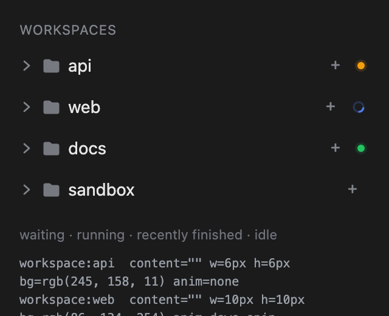

# dsh-workspace-status

Colored status marks on the **workspace rows** of the DeepSeek Harness sidebar:
waiting for you, running, and just finished.

Harness draws a status dot on every conversation row, but nothing on the
workspace (folder) row above it. Collapse a group, or scroll it out of view, and
the folder row cannot tell you that an agent inside is stuck waiting for an
approval or still working. This plugin gives the folder row the same kind of
mark, aggregated from its sessions:

| Mark | Meaning | Color |
|---|---|---|
| solid dot | at least one session is waiting for you — approval, plan review, or an answer | amber (`--dsw-alias-state-warn-primary`) |
| stroked ring, spinning | at least one session is running, including a running subagent | blue (`--dsw-static-deepseek-450`) |
| solid dot | at least one session finished recently and has not been opened since | green (`--dsw-alias-state-success-primary`) |

The mark sits in the empty right-hand end of the workspace row — the same place
a session row puts its timestamp — and does not displace the title. It appears
for expanded and collapsed groups alike, and its state is described to
screen-reader users in a hidden sentence ("Workspace activity: 2 running, 1
waiting for you — api, web").

## Preview



This is the plugin's own stylesheet rendered over a local reproduction of the
sidebar row DOM and theme tokens — a design preview, not a live screenshot. The
shipped app draws the same marks on the real rows.

## Rules

- **Precedence matches the shipped session row:** waiting for the user beats
  running, which beats the finished reminder. A workspace therefore shows one
  mark at a time; the hidden description still reports every count.
- **Subagents count as their parent's activity.** A running subagent keeps the
  parent session's workspace marked even when the parent turn has settled.
  Subagent rows never produce a mark of their own — they are not workspace
  members.
- **Archived sessions are ignored**, the same way the default browser view
  hides them.
- **The finished mark is a notice, not a flag.** It lapses one hour after the
  session's last update, or one hour after the plugin watched it stop if that
  is later. The shipped per-row green dot persists until opened; a folder row
  has no timestamp to contradict it, so a permanent green dot would outlive the
  news. A finished session that was never seen running is judged by its own
  updated time only.
- **Ungrouped sessions** mark the "Ungrouped" bucket row, which behaves like a
  workspace row in the sidebar.
- **No mark when everything is idle.** The plugin renders nothing at all in
  that case — no stylesheet, no hidden text.

The active workspace (the one containing the open conversation) is already
marked natively: Harness paints the folder icon of the active chain blue. This
plugin does not duplicate that.

## Install

From npm:

```sh
dsh plugin --profile <profile> add dsh-workspace-status
```

From a local checkout (development):

```sh
dsh plugin --profile desktop add /absolute/path/to/dsh-workspace-status
```

`dsh plugin add` links the checkout and appends this package to
`dsh.profile.bundles` because it declares `dsh.bundle`. Use the profile that
runs your client — `desktop` for the macOS/Windows app, `web` for `dsh web`.
Or use sidebar → **Plugins** → **Add plugin** and pass the absolute path to this
directory. The host half contributes nothing, but the profile composition still
changes, so **restart the profile's Host** (quit and reopen the desktop app, or
restart `dsh web`) after installing. Then reload the page if the client half
does not appear.

Manual mount without the CLI: copy the package into the profile's
`node_modules`, add `"dsh-workspace-status"` to `dsh.profile.bundles` in the
profile's `package.json`, and insert the row from `cordis.patch.yml` into the
profile's patch layer.

## Verify

1. Start a session in a workspace and collapse that group while it runs — a
   blue ring appears at the end of the folder row.
2. Trigger an approval (or a plan review / question) in a session of another
   workspace — that folder row shows an amber dot even while expanded.
3. Let a session finish without opening it — a green dot appears, and lapses an
   hour later.
4. Expand the group: the mark stays on the folder row; the session rows keep
   their own dots unchanged.
5. With every session idle, no extra element appears in the sidebar.

The client half writes nothing into the sidebar DOM — it reacts to the public
Workspace/Session feeds and emits CSS keyed on the row the browser already
renders. If the mark is missing, check the browser console for a failed client
bundle load first; nothing else in the sidebar is affected.

## How it works

- The mount is an entry in the additive `sidebar.footer.action` seat. It renders
  only a `<style>` element and a visually hidden `<span>`; it is not a control
  and adds nothing visible at the foot.
- Aggregation reads the same public data the browser uses: `useWorkspaces`
  (`items`, `archivedSessionIds`), `useSessions` (`byId`) and
  `useSessionStatus` (`running`, `pendingInteraction`, `completionUnread`).
- The visible mark is the workspace row's trailing pseudo-element, emitted as a
  rule targeting `[data-row-key="workspace:<id>"]::after`.
- Removing the plugin removes the mount, which removes the stylesheet; no state
  is written anywhere.

### The one internal dependency

`data-row-key="workspace:<id>"` is an internal detail of
`@deepseek-ai/dsh-client-ui-workspace`, not a public slot contract. A future
Harness release could rename it, in which case the marks would silently stop
appearing until this package is updated. The failure mode is deliberately
**"no indicator"**, not "broken sidebar": the plugin never touches the DOM, so a
stale selector can only produce a missing dot.

## Compatibility

- DeepSeek Harness `>=0.2.1-rc.2 <0.3.0-0` (developed and verified against
  `0.2.1-rc.3`); Web and Desktop clients.
- Node `>=22.18.0` for the build-free package and its tests.
- No runtime dependencies, no host services, no settings, no model-visible
  tools or prompt changes.

## Development

```sh
npm test
```

The suite loads the classic-script client envelope in a sandbox, drives the slot
component with fake standard hooks, and asserts the emitted stylesheet and
hidden description across waiting/running/finished, subagent, archived,
ungrouped, expiry and selector-escaping cases. A manifest test checks the bundle
patch, export map, locale parity and the loader envelope.

There is no build step: `index.js` and `client.js` are the published artifacts.

## Remove

```sh
dsh plugin --profile <profile> remove dsh-workspace-status
```

Restart the Host. The sidebar returns to stock; nothing else is left behind.

## License

MIT
